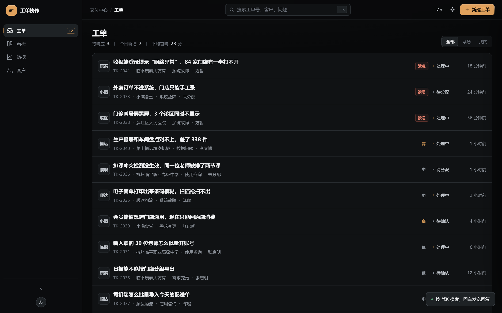
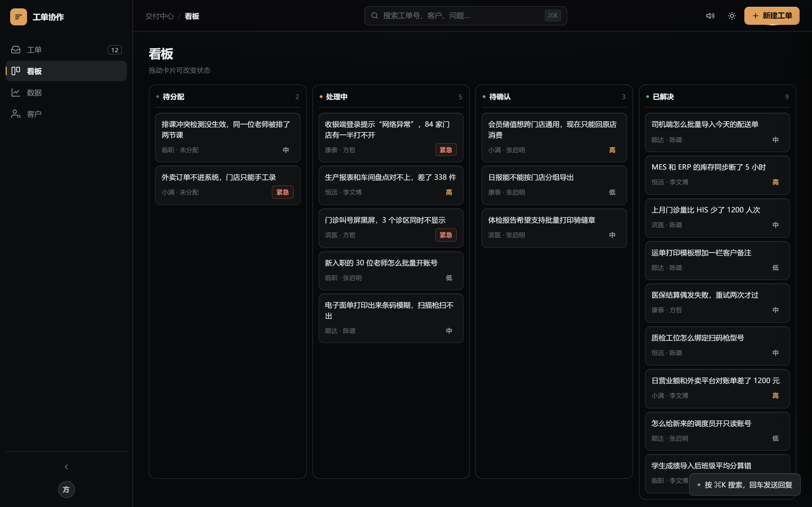
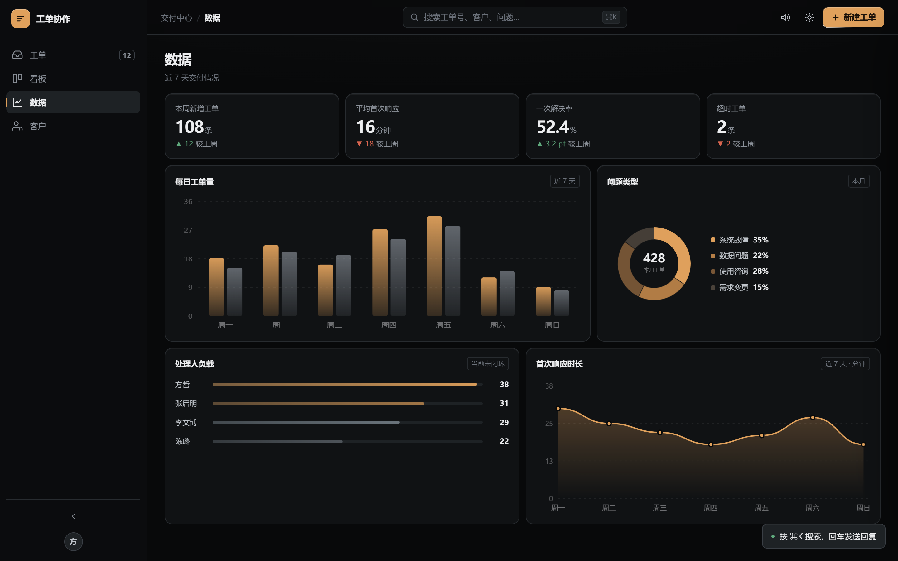
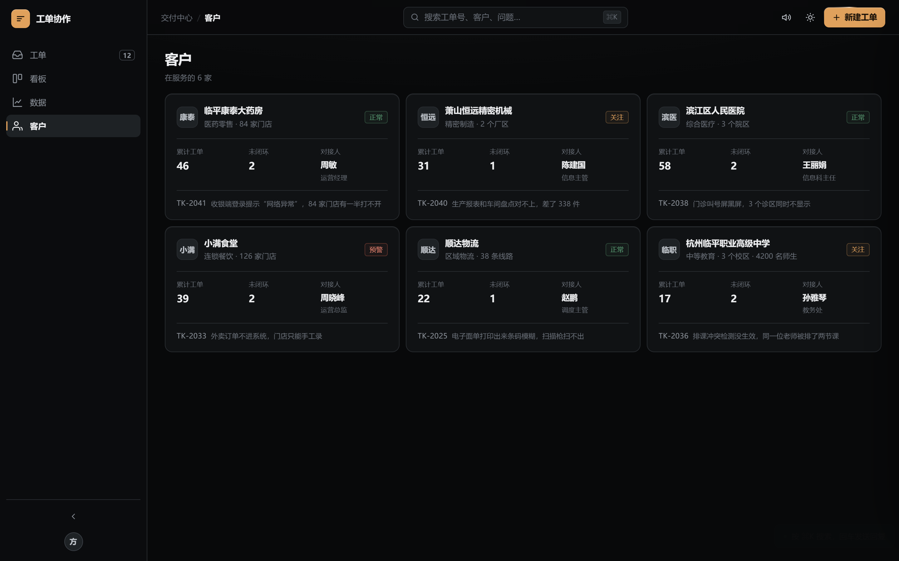

# 工单协作系统

门店建档之后的报障受理、派单、跟进与闭环在一个页面内完成，提供工单、看板、数据、客户四个视图。

## 快速开始

打开 `index.html`。页面自带 19 条工单与 6 家客户，左侧导航切换四个视图，右上角「新建工单」创建工单，顶栏可切换主题与操作音效。无需安装、无需服务端、无需联网。

## 功能特性

- **工单**：按最后活动时间倒序，支持关键字搜索与全部 / 紧急 / 我的三档筛选。
- **看板**：四列对应四个状态，拖拽卡片即更新状态并写入处理轨迹。
- **数据**：本周新增、平均首次响应、一次解决率、超时工单等指标，配每日工单量、问题类型、处理人负载与首次响应时长四张手写 SVG 图表。
- **客户**：健康度、累计工单、未闭环数量与最近一条工单；从客户卡片可查看该客户全部历史。
- **双向下钻**：工单详情可跳到客户档案，客户档案可回到工单，按问题类型可筛出同类问题。
- **相似工单**：新建工单时按标题实时提示历史相近工单；详情底部按同客户、同类型列出相关工单，计算在浏览器本地完成。
- **界面反馈**：边缘流光、指针磁吸、点击火花、卡片聚光、光泽扫过与可开关的操作音效；支持浅色主题与系统减少动画设置。

## 技术实现

单页原生 HTML / CSS / JavaScript，无框架、无构建步骤、无网络请求。

`js/data.js` 提供工单、客户、状态与统计口径；`js/ai.js` 把每条工单的标题、描述与类型切成中文字符二元组，构建词频与逆文档频率索引，按余弦相似度排序，相似度过低时退回通用模板；`js/app.js` 负责四视图渲染、拖拽、筛选、抽屉与弹层；`js/effects.js` 通过事件委托写入指针坐标与临时节点，`css/effects.css` 用 CSS 动画消费这些变量；`js/audio.js` 用 Web Audio 合成操作音效，不加载音频文件。

## 验收结果

本机无头浏览器逐项验收，12 项交互全部通过，页面 JS 错误 0 条，逐项数据见 `eval/验收结果.json`。详见 [验收报告](docs/验收报告.md)。

| 项目 | 实测 |
| --- | --- |
| 四视图 | 工单 / 看板 / 数据 / 客户均可切换 |
| 渲染量 | 列表 19 条、看板 19 卡、图表 55 个 SVG 节点、客户 6 家 |
| 搜索 | 全部 19 条 → 搜「收银」1 条 |
| 筛选 | 紧急 3 条 |
| 相似检索 | 输入「收银端登录提示网络异常」返回 2 条，最高 59% |
| 交互 | 创建工单、看板拖拽改状态、工单与客户下钻、音效开关、主题切换全部生效 |

## 已知限制

- 数据保存在页面内存中，刷新后回到初始状态，没有服务端持久化。
- 拖拽基于 HTML5 Drag 事件，触屏设备不可用。
- 相似工单依赖词频匹配，同一问题换一种措辞时匹配度会下降。
- 图表为手写 SVG，数据结构变化需同步调整绘制逻辑。
- 工单与客户数据内置于 `js/data.js`，更换业务场景需替换该文件。
